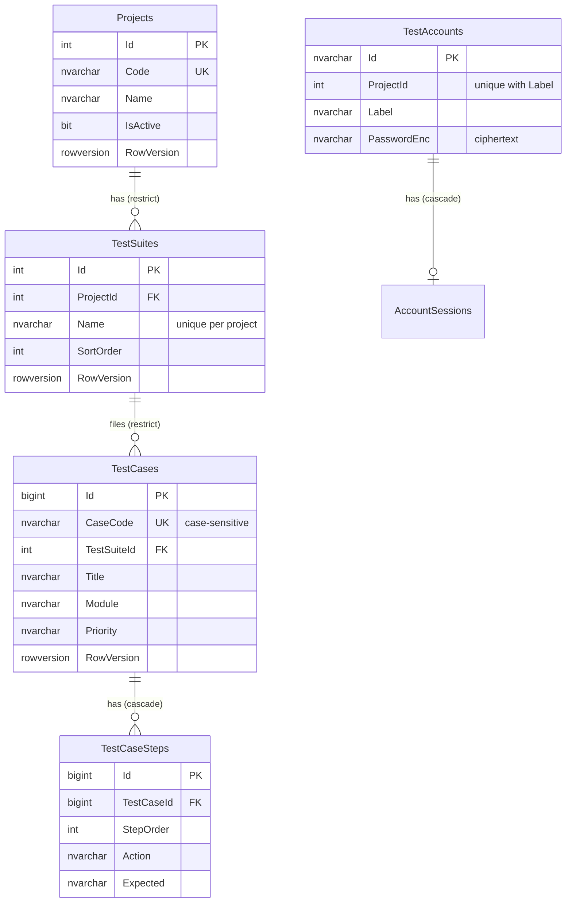

# Database

What the storage was, what it is now, and why. Decision record: [adr/0005](adr/0005-sql-server-and-dotnet-api.md).

## 1. What was there before

The brief described file-based test case storage. The code had moved on from that: **SQLite was the master copy, and
JSON files were a mirror of part of it.** There were also no projects, tasks or master data in the product.

| Data                             | Where                                 | Read                                      | Written                                     |
| -------------------------------- | ------------------------------------- | ----------------------------------------- | ------------------------------------------- |
| Test cases                       | SQLite `test_cases` (JSON per row)    | Once at start-up into a `Map`             | Write-through on every change               |
| Scenarios (draft, approved)      | SQLite `scenario_drafts`, `_approved` | Once at start-up                          | On every save                               |
| Scenario history                 | SQLite `scenario_history`             | On demand                                 | When a version is replaced                  |
| Approved steps, mirrored         | `test-data/scenarios/TC_xx.json`      | At start-up; a hand edit became a version | After every approved change                 |
| Test data values                 | `test-data/test-data.json`            | From disk before every test case          | Whole file, write then rename               |
| Runs                             | SQLite `runs`                         | Newest 100 at start-up                    | On every state change                       |
| Settings, AI provider, page list | SQLite `settings`                     | At start-up                               | On save                                     |
| Accounts, sessions, AI keys      | SQLite (ciphertext; key in a file)    | On demand                                 | On save                                     |
| Audit log                        | SQLite `audit`                        | On demand                                 | On every change                             |
| Backups before "clear all"       | `data/backups/*.json`                 | On demand                                 | Before clearing; 7-day retention            |
| Evidence (screenshots, traces)   | `artifacts/<run>/...`                 | On demand                                 | During runs. **Unchanged: these are files** |
| Knowledge search index           | SQLite FTS5 tables                    | Queries                                   | Rebuilt from the above. **Now in memory**   |

Flow: browser → Fastify (`services/qa-api/src/app.ts`) → services (synchronous) → `SqliteStorage`, plus the JSON mirror.

## 2. What it is now

```
Browser ──► QaStudio.Api (.NET 10, 127.0.0.1:5080) ──► SQL Server  LKH2LP0028\SQLSERVER, database QaStudio
            │  Projects, Test suites, Test cases, Audit           ▲
            │  Security checks; serves the built frontend         │ POST /internal/persistence/batch
            │                                                     │ GET  /internal/persistence/snapshot
            └─ Forwards everything else ──► Node worker (127.0.0.1:4000)
                                            Playwright, Excel, step library, AI, live events
                                            Holds no data on disk (apart from run evidence)
```

**One system of record.** SQL Server is the only copy. The JSON mirror, the scenario folder and the file loader are gone
from production code.

**Why a worker remains.** Running tests, parsing Excel, validating steps and the AI agents are about 10,900 lines of
TypeScript with 340+ tests behind them. Rewriting them was weighed and rejected for now: see the ADR.

**How the worker stays correct without a local database.** Its services are synchronous, so `RemoteStorage`
(`Backend/Worker/services/qa-api/src/remote-storage.ts`) keeps a private in-memory copy for reads, loaded from the API at start-up, and
sends every write to the API in order. Then:

- A request that changed something is not answered until its writes have committed. If the database cannot take them,
  the person gets a 503, and the writes stay queued and are retried in order.
- Test cases changed through .NET reach the worker by notice (`/internal/sync/test-cases`). The worker also re-reads the
  whole list before starting a run, so a missed notice cannot make a run use stale cases.
- If a write is refused as invalid, it is dropped and logged, so it cannot block later ones. It remains in the worker's
  memory until the next restart.

**Limit worth knowing.** Writes made directly in SQL, or through a second API instance, reach the worker only at its
next start or run. Run one API and one worker per database.

## 3. Schema

Project → Test Suite → Test Case is the hierarchy from the brief. "Task" is called **Test Suite**, the usual QA term.
"Master Data Configuration" is the Projects start page plus each project's Project settings: projects, their versions and their test suites are the master data.



Also: `ScenarioRecords`, `ScenarioRevisions`, `TestRuns`, `ConfigEntries`, `TestAccounts`, `AccountSessions`,
`AiProviderKeys`, `AuditLog`, `DataBackups`, and `ProjectVersions` (one project's releases; `TestCases.ProjectVersionId` points to
one, `ON DELETE SET NULL`, unique name per project). `TestDataValues` was dropped by the `AddProjectVersionsRemoveTestData`
migration (2026-11-09); its values were first copied into `ConfigEntries['legacy-test-data']`, where parameter auto-fill offers
them. Parameter values live in the tables `CaseParameterValues` and `ProjectParameterValues` (migrated from the old `case-parameters` and `project-parameters` config blocks, which are kept for one release), per-project pages in `ConfigEntries['pages:<projectId>']`.

Choices that are not obvious:

- **Test cases are relational; scenarios and runs are JSON documents** (with an `ISJSON` check, and status and version
  surfaced as columns). A scenario's shape belongs to the worker's step library and changes with it. Nobody queries inside
  it in SQL. Normalising it would mean two schemas to keep in step for no query that needs it.
- **Scenarios have no foreign key to test cases.** A scenario outlives a deleted case until revoked. That is how the
  product already behaved, and a foreign key would change it.
- **`CaseCode` is case-sensitive** (binary collation). `tc_01` and `TC_01` are different cases in the worker, so under the
  default collation they would collide here.
- **Deletes are `RESTRICT` down the hierarchy.** One click must not be able to remove a project's whole test library.
- **`rowversion` on the master tables** gives optimistic concurrency: a stale save gets a 409, not a silent overwrite.
- **Imports know nothing about suites**, so a new case is filed by its module: the module becomes a suite in the `GENERAL`
  project (or `Unassigned` if there is no module). People can then move cases. Later worker writes do not undo a move.
- **Undo of "clear all" keeps filing.** A backup is the worker's document, which has no suites, so `DataBackups.FilingJson`
  records where each case was, and is applied after a restore.
- **Audit is read by .NET**, because it has to show changes from both sides.
- **A test account belongs to a project, with no foreign key** (`TestAccounts.ProjectId`, unique with `Label`). Accounts are written by
  the worker's queue, where a refused write loses its batch. Deleting a project refuses while it has accounts. Each project's address and
  sign-in are the `project-connections` block in `ConfigEntries`: see [adr/0006](adr/0006-per-project-connection.md).

### Indexes

`UX Projects(Code)`, `UX TestSuites(ProjectId, Name)`, `UX TestCases(CaseCode)`, `IX TestCases(TestSuiteId, Id)` (filter by
suite in added order), filtered `IX TestCases(Module)` and `(Priority)`, `IX TestCaseSteps(TestCaseId, StepOrder)`,
`IX TestRuns(CreatedAtUtc DESC)`.

## 4. Performance

Measured on the development server through the real API, with 100,000 test cases, 500,000 steps, 5 projects, 100 suites.
Times are the second and third of three calls, so after warm-up. SQL Server's missing-index report was empty afterwards.

| Request                        | Time          |
| ------------------------------ | ------------- |
| One case (compiled query)      | 7–30 ms       |
| List, by suite, page 1         | 6–9 ms        |
| List, by suite, page 30        | 12–14 ms      |
| List, by project               | 21–31 ms      |
| List, by module / by priority  | 10–19 ms      |
| List, unfiltered, 25 rows      | 55–69 ms      |
| List, unfiltered, 200 rows     | 78–87 ms      |
| List, unfiltered, page 3000    | 95–110 ms     |
| Projects or suites with counts | 44–63 ms      |
| Next free case ID              | 320–330 ms    |
| **Text search (`q=`)**         | **2.3–3.8 s** |

**Known limits at that volume:**

- **Text search** is `LIKE '%x%'` over three columns and scans the table. The current UI does not call it, because it
  filters in the browser. If it is needed, add a full-text index on `Title` and `Module`.
- **The UI loads every case into the browser** (200 per request), an existing design that lets filters combine. 100,000
  cases would take about 500 requests. It is comfortable to roughly 10,000–20,000; beyond that the list needs server-side
  filtering, which the API already supports.
- **The worker holds every case in memory**, for the same reason.

Also in place: pooled `DbContext`s and SqlClient connection pooling (sizes in the connection string), parameterised queries
only (EF Core, and Dapper with parameters for flat reads and aggregates — see [adr/0008](adr/0008-dapper-read-side.md)), compiled
queries on the hot paths, split queries for lists so steps do not multiply wide case rows, no-tracking
reads, an in-memory master data cache invalidated on every write, a configurable `CommandTimeout`, and retry on transient SQL
errors. MARS is off because nothing needs it.

**Partitioning** is not applied: nothing is near needing it. If `TestRuns` grows into the millions, partition by month on
`CreatedAtUtc` (Enterprise Developer on this server supports it) and move old months out with partition switching.

## 5. Data migration

Done once, on 2026-11-02, through the same batch route as live writes. Verified field by field against the source: 30 test cases and 24 approved
scenarios; by count and spot checks: 2 earlier versions, 25 runs, 1 account, 14 audit entries, 24 test data values, settings.

The old storage and the import tool were then removed from the project. They are in the backup made that day,
`QA_STUDIO_backup_2026-11-02.tgz`, beside the project folder. The file `Backend/tools/migrate-legacy-data.mjs` in it can import again if ever needed.
It reads `QA_LEGACY_DB`, `QA_LEGACY_SCENARIOS` and `QA_LEGACY_TEST_DATA` for the locations.

**Keep `Backend/Worker/data/secret.key`:** it decrypts the stored account password and AI keys. Back it up apart from the database.
